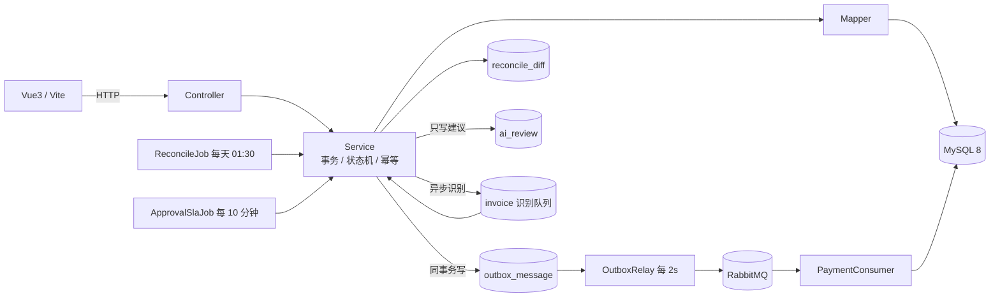

# Smart Expense · 智能报销审批系统

> 一个把「提交 → 三级审批 → 预算冻结 → 消息驱动付款 → 每日对账」跑通的报销系统，
> 重点不在 CRUD，而在**状态机、并发控制、最终一致性，以及 AI 只建议不决策的边界**。


## 为什么值得看

报销系统最容易写成"一堆 UPDATE status"，这个项目刻意把几个容易翻车的地方做成了可讲的设计：

| 问题 | 处理方式 |
|---|---|
| 状态乱飞 | 所有流转只走 `ReportStateMachine`，非法流转统一 409，禁止业务代码直接改状态 |
| 并发审批 / 重复提交 | 整级行锁 + `WHERE status='PENDING'` 条件更新；`submit_token` 唯一索引幂等回放 |
| 预算超发 | 冻结/扣减/释放都是"把校验写进 WHERE"的条件更新，金额不会减成负数 |
| 消息丢失 / 重复 | Outbox 与业务同事务写入，调度器租约 + 指数退避；消费端日志幂等 + 死信 |
| 数据漂移 | 每日对账检出四类差异，能修的自动补偿，不能修的转人工 |
| 审批没人管 | SLA 定时扫描：先提醒、超 1 个 SLA 自动升级（只换审批人，不动单据状态） |
| AI 乱给建议 | 建议独立成 `ai_review` 表，只建议不阻断；风险只能升不能降，`evidence` 白名单防幻觉 |
| 发票识别失败 | 异步识别 + 降级链 + 人工复核队列；失败不 requeue 放大调用；字段级置信度 |

## 功能地图

| 模块 | 能力 |
|---|---|
| 审批流 | 提交 / 撤回 / 编辑 / 删除草稿、三级审批、会签与或签、转交（防环）、已办 |
| 预算 | 提交冻结、驳回/撤回释放、末级通过实扣、部门预算分发与追加流水、公司总预算池 |
| 可靠消息 | Outbox、RabbitMQ、消费幂等、死信、付款单自动生成 |
| 对账 | 缺扣 / 缺付款单 / 金额不一致 / 状态卡死四类差异 + 自动补偿 |
| 审批 SLA | 超时提醒（去重）、超 SLA 自动升级 |
| AI 审批 Copilot | 硬规则 + Agent 工具循环，只写建议表；领取/忽略写审计，可算采纳率 |
| 发票 | 上传、异步识别（Mock / qwen-vl 可切换）、字段级置信度、复核、重试、图片预览、辅助填入 |
| 管理后台 | 总预算池、部门预算分配、用户赋权、识别指标、发票硬规则 |
| 前端 | 登录 / 报销单 / 新建编辑 / 详情 / 审批待办与已办 / 付款单 / 发票复核 / 管理后台 |

## 架构



- **同步链路**：状态机 + 条件更新 + 唯一键，保证单次操作正确；
- **异步链路**：Outbox 同事务写入 → MQ → 消费幂等，保证下游最终一致；
- **兜底**：每日对账自动补偿；SLA 定时提醒/升级；识别失败转人工复核。

更多设计见 [`docs/09-系统架构.md`](docs/09-系统架构.md)。

## 技术栈

| 组件 | 用途 |
|---|---|
| Java 17 / Spring Boot 4.1.1 | Web / 事务 / 定时任务 |
| MyBatis-Plus 3.5 | ORM 与条件更新 |
| MySQL 8 | 主存储（状态机、预算、Outbox、对账、AI 建议、发票） |
| RabbitMQ 3.13 | 异步识别、付款单生成、死信 |
| Redis 7 | 预留（当前未使用） |
| Vue3 + Vite 5 | 前端（原生 CSS，无 UI 框架） |
| JUnit 5 / Mockito / Vitest | 后端与前端测试 |

## 快速开始

```bash
# 1) 基础设施：MySQL 3307 / Redis 6380 / RabbitMQ 5672
cd Smart-Expense
docker compose up -d

# 2) 启动后端（首次启动自动导入 sql/schema.sql 与 sql/seed.sql）
./mvnw spring-boot:run                 # http://localhost:8080

# 3) 启动前端
cd ../frontend
pnpm install
pnpm dev                               # http://localhost:5173，/api 由 Vite 代理到 8080

# 4) 测试
cd ../Smart-Expense && ./mvnw -o test  # 92 个后端用例
cd ../frontend && pnpm test            # 11 个前端用例（vitest）

# 5) 单端口演示（可选）：把前端产物拷进 Spring Boot static/
pwsh -File ../scripts/copy-frontend.ps1
# 重启后端后只访问 http://localhost:8080，不再需要 5173

# 6) 只读链路压测（可选）
node ../scripts/load-test.mjs --concurrency 10 --duration 15
```

**演示账号**（`sql/seed.sql`，密码统一 `123456`）：

| 账号 | 角色 | 说明 |
|---|---|---|
| `linyi` | 员工 | 建单、提交、撤回 |
| `zhangsan` | 直属主管 | 一级审批、转交 |
| `wangwu` | 财务 | 二级审批、付款确认、发票复核 |
| `zhaoliu` | 分管 | 三级审批 |
| `admin` | 管理员 | 预算、用户、对账、指标 |

## 质量与数据（真实输出）

| 项 | 结果 |
|---|---|
| 后端测试 | `mvnw -o test` → **92/92** |
| 前端测试 | `pnpm test` → **11/11**（status / request / StatusTag） |
| 前端构建 | `pnpm build` → **49 modules** |
| 只读压测（10 并发 × 15s） | 列表 QPS **270.33** / P95 **15.3ms**；详情 QPS **270.27** / P95 **34.4ms**，错误率 0 |

> 压测是本机单机 + Docker MySQL + 默认 mock 识别 + 只读链路，不代表生产容量；完整环境与局限见
> [`docs/20-压测报告.md`](docs/20-压测报告.md)。**没有写路径压测，不对外宣称写吞吐。**

## 接口一览

完整契约（含实现状态）见 [`docs/03-接口清单.md`](docs/03-接口清单.md)。

| 分组 | 代表接口 |
|---|---|
| 认证 | `POST /auth/login`、`GET /auth/me` |
| 报销单 | `POST /reports`、`GET /reports`、`PUT/DELETE /reports/{id}`、`submit`、`withdraw`、`timeline` |
| 审批 | `GET /approvals/pending|handled`、`approve`、`reject`、`transfer`、`transfer-candidates` |
| 预算 | `GET /budgets`、`PUT /budgets/{deptId}`、`GET/PUT /budgets/pool` |
| 发票 | `POST /invoices/upload`、`GET /invoices`、`review`、`retry`、`file` |
| 付款/对账/指标 | `GET /payments`、`confirm`、`admin/reconcile/*`、`admin/metrics` |
| 管理 | `admin/users`、`admin/users/page`、`admin/ai-review/refresh` |

认证：`Authorization: Bearer <JWT>`；兼容期可用 `X-User-Id`（仅本地调试）。

## 文档导航

| 文档 | 内容 |
|---|---|
| [`docs/01-表结构.md`](docs/01-表结构.md) | 表、索引、逻辑删除、审批链快照 |
| [`docs/02-状态机.md`](docs/02-状态机.md) | T1–T6 流转、节点状态、会签/或签/转交、SLA |
| [`docs/03-接口清单.md`](docs/03-接口清单.md) | 接口契约、幂等、错误码、实现状态 |
| [`docs/06-预算冻结与扣减.md`](docs/06-预算冻结与扣减.md) | 冻结/释放/实扣与总池约束 |
| [`docs/07-Outbox与消息一致性.md`](docs/07-Outbox与消息一致性.md) | 消息不丢/不重的实现 |
| [`docs/08-对账与自动补偿.md`](docs/08-对账与自动补偿.md) | 四类差异与修复边界 |
| [`docs/11-AI识别与辅助审核.md`](docs/11-AI识别与辅助审核.md) | 识别链路、Agent、校验、降级 |
| [`docs/14-前端设计.md`](docs/14-前端设计.md) | 页面、交互、动效、单端口部署 |
| [`docs/16-经验与踩坑.md`](docs/16-经验与踩坑.md) | 工程经验与排障手记 |
| [`docs/17-面试核心技术与高频问答.md`](docs/17-面试核心技术与高频问答.md) | 面试讲法、问答、复盘 |
| [`docs/18-接入真实AI.md`](docs/18-接入真实AI.md) | mock → qwen-vl 的切换与排障 |
| [`docs/19-体验闭环设计.md`](docs/19-体验闭环设计.md) | 辅助填入、识别指标、已办、发票硬规则 |
| [`docs/20-压测报告.md`](docs/20-压测报告.md) | 压测环境、数字、局限 |

## 目录

```
.
├─ docs/                 # 设计文档（01–20，按主题编号）
├─ sql/                  # schema.sql + seed.sql（Docker 首次启动自动导入）
├─ frontend/             # Vue3 + Vite（登录/列表/表单/详情/待办/付款/复核/管理后台）
├─ scripts/              # copy-frontend.ps1（单端口部署）、load-test.mjs（只读压测）
├─ Smart-Expense/        # Spring Boot 工程
│  ├─ src/main/java/com/occ/smartexpense/
│  ├─ src/test/java/com/occ/smartexpense/
│  └─ docker-compose.yml
└─ README.md
```

## 已知限制（诚实清单）

- 云 OCR 主实现未接（`InvoiceRecognizer` 扩展点已留，接厂商 SDK 即可）；当前真实识别走多模态 `qwen3-vl-plus`。
- 压测只覆盖只读链路，写路径（提交/审批/上传/并发审批）未压。
- Redis 只预留，未做缓存/分布式锁。
- 前端测试覆盖 3 个模块（status / request / StatusTag），表单与复核弹窗未覆盖。

## License

[MIT](LICENSE)
