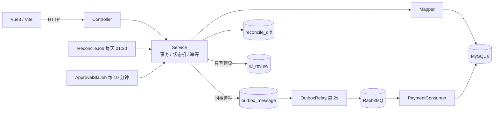

# Smart Expense · 智能报销审批系统

> 一个覆盖「提交 → 多级审批 → 预算冻结 → 消息驱动付款 → 自动对账」的完整报销系统，重点在状态机、并发控制与数据最终一致性。


## 特性

- **状态机驱动的审批流**：草稿 → 待审批 → 审批中 → 已通过 / 已驳回 → 已付款，非法流转统一拒绝。
- **审批链快照**：提交时固化审批人、级次与超时时间，组织调整不影响在途单。
- **预算冻结与实扣**：提交冻结、撤回/驳回释放、末级通过转实扣，条件更新防超发；支持部门预算追加流水与公司总预算池约束。
- **可靠消息（Outbox）**：业务与消息同事务，调度器租约投递 + 指数退避，消费端幂等 + 死信。
- **每日对账**：四类差异（缺扣 / 缺付款单 / 金额不一致 / 状态卡死），能修的自动修，不能修的转人工。
- **审批 SLA**：定时扫描超时节点，先提醒、超 1 个 SLA 自动升级（改人不动单据状态）。
- **AI 辅助审核**：硬规则 + Agent 只写建议表，不阻断审批；风险只能升不能降，建议带版本过期判定。
- **发票识别**：上传后异步识别（Mock / qwen-vl 可切换），字段级置信度 + 人工复核队列 + 重试；同人同图复用、跨人同图标疑似重复。
- **Vue3 前端**：登录 / 我的报销单 / 新建编辑 / 详情 / 审批待办 / 付款单 / 发票复核 + 管理后台（预算、用户赋权）。
- **测试**：**87 个用例**覆盖状态机、提交/撤回/删除、并发审批、SLA、付款确认、Outbox 投递、对账四类差异、AI 重算、预算追加、发票识别/复核/重试。

## 架构



- **同步链路**：状态机 + 条件更新 + 唯一键，保证单次操作正确；
- **异步链路**：Outbox 同事务写入 → MQ → 消费幂等，保证下游最终一致；
- **兜底**：每日对账检出差异并自动补偿；审批 SLA 定时提醒/升级。

更多设计见 [`docs/09-系统架构.md`](docs/09-系统架构.md)。

## 技术栈

| 组件 | 版本 | 用途 |
|---|---|---|
| Java | 17 | 语言 |
| Spring Boot | 4.1 | Web / 事务 / 调度 |
| MyBatis-Plus | 3.5 | ORM 与条件更新 |
| MySQL | 8.0 | 主存储 |
| RabbitMQ | 3.13 | 异步消息与死信 |
| Redis | 7 | 预留缓存/分布式锁 |
| JUnit 5 / Mockito | — | 测试 |

## 快速开始

```bash
# 1. 启动依赖（MySQL 3307 / Redis 6380 / RabbitMQ 5672）
cd Smart-Expense
docker compose up -d

# 2. 启动后端（首次启动自动导入 sql/schema.sql 与 sql/seed.sql）
./mvnw spring-boot:run        # http://localhost:8080

# 3. 启动前端（Node 24 + pnpm）
cd ../frontend
pnpm install
pnpm dev                      # http://localhost:5173，/api 走 Vite proxy → 8080

# 4. 运行测试（需要 MySQL 已启动）
cd ../Smart-Expense && ./mvnw -o test
```

手动导入 SQL：

```bash
mysql -uroot -p --default-character-set=utf8mb4 < sql/schema.sql
mysql -uroot -p --default-character-set=utf8mb4 < sql/seed.sql
```

RabbitMQ 管理页：http://127.0.0.1:15672（guest/guest）。

## 接口

| 方法 | 路径 | 说明 |
|---|---|---|
| POST | `/api/v1/auth/login` | 登录，返回 JWT |
| GET | `/api/v1/auth/me` | 当前用户与角色 |
| POST | `/api/v1/reports` | 创建报销单草稿 |
| GET | `/api/v1/reports` | 分页列表（`scope=mine/dept/all`、`status`、`keyword`） |
| GET | `/api/v1/reports/{id}` | 单据详情（含可执行动作、AI 建议） |
| PUT | `/api/v1/reports/{id}` | 编辑草稿（仅本人 + DRAFT） |
| DELETE | `/api/v1/reports/{id}` | 删除草稿（逻辑删除，仅本人 + DRAFT） |
| POST | `/api/v1/reports/{id}/submit` | 提交（`Idempotency-Key`） |
| POST | `/api/v1/reports/{id}/withdraw` | 撤回 |
| GET | `/api/v1/reports/{id}/timeline` | 审批轨迹 |
| GET | `/api/v1/approvals/pending` | 我的待办 |
| GET | `/api/v1/approvals/handled` | 我的已办 |
| GET | `/api/v1/approvals/transfer-candidates` | 转交候选人（防环过滤） |
| POST | `/api/v1/approvals/{id}/approve` | 通过 |
| POST | `/api/v1/approvals/{id}/reject` | 驳回 |
| POST | `/api/v1/approvals/{id}/transfer` | 转交 |
| GET | `/api/v1/budgets` | 部门预算（`period`） |
| PUT | `/api/v1/budgets/{deptId}` | 调整/追加预算（`mode=SET/ADD`） |
| GET | `/api/v1/budgets/pool` | 公司总预算池 |
| PUT | `/api/v1/budgets/pool` | 设置总预算（不得低于已分配） |
| POST | `/api/v1/invoices/upload` | 上传发票（multipart，异步识别） |
| GET | `/api/v1/invoices` | 复核队列（`ocrStatus` 筛选，FINANCE/ADMIN） |
| GET | `/api/v1/invoices/{id}` | 发票详情（字段级置信度、识别器、疑似重复） |
| GET | `/api/v1/invoices/{id}/file` | 发票文件流 |
| PUT | `/api/v1/invoices/{id}/review` | 人工复核（置 SUCCESS） |
| POST | `/api/v1/invoices/{id}/retry` | 重试识别 |
| GET | `/api/v1/payments` | 付款单列表 |
| POST | `/api/v1/payments/{id}/confirm` | 付款回执确认 |
| POST | `/api/v1/admin/reconcile/run` | 触发对账 |
| GET | `/api/v1/admin/reconcile/diffs` | 对账差异 |
| GET | `/api/v1/admin/metrics` | 运营指标 |
| GET | `/api/v1/admin/users` | 用户列表 |
| PUT | `/api/v1/admin/users/{id}/roles` | 全量覆盖角色 |
| POST | `/api/v1/admin/ai-review/refresh` | 重算 AI 建议（仅 ADMIN） |

认证：`POST /auth/login` 获取 JWT，之后带 `Authorization: Bearer <token>`。
兼容期可继续用请求头 `X-User-Id`（seed 数据：1 林一 / 2 张三 / 4 王五 / 5 赵六 / 6 管理员），默认密码 `123456`。
完整契约与实现状态见 [`docs/03-接口清单.md`](docs/03-接口清单.md)。

## 设计要点

| 问题 | 方案 |
|---|---|
| 重复提交 | `submit_token` 唯一索引 + 幂等回放 |
| 重复审批 | 整级行锁 + `WHERE status='PENDING'` 条件更新 |
| 预算超发 | `WHERE total-used-frozen >= amount` 条件更新 |
| 消息不丢 | Outbox 与业务同事务，调度器轮询重试 |
| 消息重复 | `msg_id` + 消费日志联合主键 + 付款单唯一键 |
| 数据漂移 | 每日对账 + 自动补偿 + 人工修复 |
| 审批超时 | 定时扫描 + 提醒去重 + 超 SLA 升级（只换人不动单据） |
| AI 幻觉 | 硬规则独立落库 + 风险只能升不能降 + `evidence` 白名单 |
| 识别失败 | 不 requeue 放大调用；降级链 + MANUAL 人工兜底；`file_hash` 复用控成本 |

## 目录

```
.
├─ docs/                 # 设计文档（状态机、表结构、消息、对账、架构、前端、经验）
├─ sql/                  # 建表与演示数据
├─ frontend/             # Vue3 + Vite 前端（登录/列表/表单/详情/待办/付款/管理后台）
├─ scripts/              # 本地预览脚本
├─ Smart-Expense/        # Spring Boot 工程
│  ├─ src/main/java/com/occ/smartexpense/
│  ├─ src/test/java/com/occ/smartexpense/
│  └─ docker-compose.yml
└─ README.md
```

## License

[MIT](LICENSE)
