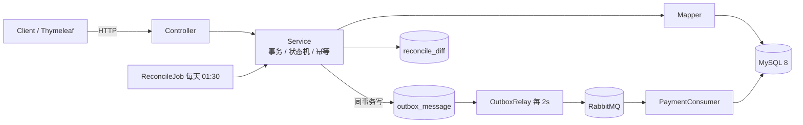

# Smart Expense · 智能报销审批系统

> 一个覆盖「提交 → 多级审批 → 预算冻结 → 消息驱动付款 → 自动对账」的完整报销系统，重点在状态机、并发控制与数据最终一致性。


## 特性

- **状态机驱动的审批流**：草稿 → 待审批 → 审批中 → 已通过 / 已驳回 → 已付款，非法流转统一拒绝。
- **审批链快照**：提交时固化审批人、级次与超时时间，组织调整不影响在途单。
- **预算冻结与实扣**：提交冻结、撤回/驳回释放、末级通过转实扣，条件更新防超发。
- **可靠消息（Outbox）**：业务与消息同事务，调度器租约投递 + 指数退避，消费端幂等 + 死信。
- **每日对账**：四类差异（缺扣 / 缺付款单 / 金额不一致 / 状态卡死），能修的自动修，不能修的转人工。
- **运营指标**：提交数、通过率、平均审批耗时、待付款、待处理差异、死信数。
- **测试**：27 个用例覆盖状态机、提交/撤回、付款确认、Outbox 投递与对账四类差异。

## 架构



- **同步链路**：状态机 + 条件更新 + 唯一键，保证单次操作正确；
- **异步链路**：Outbox 同事务写入 → MQ → 消费幂等，保证下游最终一致；
- **兜底**：每日对账检出差异并自动补偿。

更多设计见 [`docs/09-系统架构.md`](docs/09-系统架构.md)。

## 技术栈

| 组件 | 版本 | 用途 |
|---|---|---|
| Java | 17 | 语言 |
| Spring Boot | 4.1 | Web / 事务 / 调度 |
| MyBatis-Plus | 3.5 | ORM 与条件更新 |
| MySQL | 8.0 | 主存储 |
| RabbitMQ | 3.13 | 异步消息与死信 |
| Redis | 7 | 预留缓存/分布式锁 |
| JUnit 5 / Mockito | — | 测试 |

## 快速开始

```bash
# 1. 启动依赖（MySQL 3307 / Redis 6380 / RabbitMQ 5672）
cd Smart-Expense
docker compose up -d

# 2. 启动应用（首次启动自动导入 sql/schema.sql 与 sql/seed.sql）
./mvnw spring-boot:run

# 3. 运行测试（需要 MySQL 已启动）
./mvnw -o test
```

手动导入 SQL：

```bash
mysql -uroot -p --default-character-set=utf8mb4 < sql/schema.sql
mysql -uroot -p --default-character-set=utf8mb4 < sql/seed.sql
```

RabbitMQ 管理页：http://127.0.0.1:15672（guest/guest）。

## 接口

| 方法 | 路径 | 说明 |
|---|---|---|
| POST | `/api/v1/reports` | 创建报销单草稿 |
| GET | `/api/v1/reports/{id}` | 单据详情（含可执行动作） |
| POST | `/api/v1/reports/{id}/submit` | 提交（`Idempotency-Key`） |
| POST | `/api/v1/reports/{id}/withdraw` | 撤回 |
| GET | `/api/v1/approvals/pending` | 我的待办 |
| POST | `/api/v1/approvals/{id}/approve` | 通过 |
| POST | `/api/v1/approvals/{id}/reject` | 驳回 |
| GET | `/api/v1/payments` | 付款单列表 |
| POST | `/api/v1/payments/{id}/confirm` | 付款回执确认 |
| POST | `/api/v1/admin/reconcile/run` | 触发对账 |
| GET | `/api/v1/admin/reconcile/diffs` | 对账差异 |
| GET | `/api/v1/admin/metrics` | 运营指标 |

身份暂用请求头 `X-User-Id`（seed 数据：1 林一 / 2 张三 / 4 王五 / 5 赵六 / 6 管理员）。

## 设计要点

| 问题 | 方案 |
|---|---|
| 重复提交 | `submit_token` 唯一索引 + 幂等回放 |
| 重复审批 | 整级行锁 + `WHERE status='PENDING'` 条件更新 |
| 预算超发 | `WHERE total-used-frozen >= amount` 条件更新 |
| 消息不丢 | Outbox 与业务同事务，调度器轮询重试 |
| 消息重复 | `msg_id` + 消费日志联合主键 + 付款单唯一键 |
| 数据漂移 | 每日对账 + 自动补偿 + 人工修复 |

## 目录

```
.
├─ docs/                 # 设计文档（状态机、表结构、消息、对账、架构）
├─ sql/                  # 建表与演示数据
├─ Smart-Expense/        # Spring Boot 工程
│  ├─ src/main/java/com/occ/smartexpense/
│  ├─ src/test/java/com/occ/smartexpense/
│  └─ docker-compose.yml
└─ README.md
```

## License

[MIT](LICENSE)
