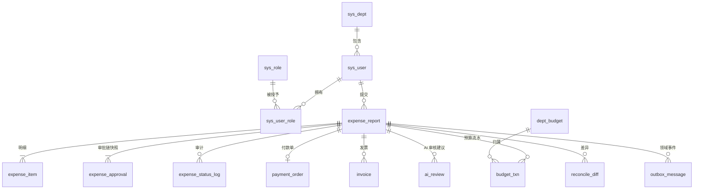

# 01 表结构设计

> 建表脚本：[`sql/schema.sql`](../sql/schema.sql)；演示数据：[`sql/seed.sql`](../sql/seed.sql)。
> 本页回答"为什么这样设计"，字段详情以脚本为准。

## 1. 约定

| 项 | 约定 |
|---|---|
| 存储 | MySQL 8.0，InnoDB，`utf8mb4_0900_ai_ci` |
| 主键 | `BIGINT UNSIGNED AUTO_INCREMENT`；组织/角色等字典表用固定 ID |
| 金额 | `DECIMAL(14,2)`，禁止 `FLOAT/DOUBLE`；币种 `CHAR(3)` 默认 `CNY` |
| 时间 | `DATETIME(3)`；`created_at/updated_at` 由数据库维护 |
| 状态 | `VARCHAR` 存枚举码（可读、便于排查），合法性由应用层状态机校验（见 02） |
| 逻辑删除 | 仅 `expense_report.deleted`，只允许作用于 `DRAFT`；其余表物理保留 |
| 命名 | 索引 `idx_*`，唯一约束 `uk_*`，外键**不建**（由应用保证，避免分库/归档耦合） |

## 2. 表清单（17 张，下表按功能归为 15 组）

| # | 表 | 作用 | 关键约束 |
|---|---|---|---|
| 1 | `sys_dept` | 部门树 | `idx_parent` |
| 2 | `sys_user` | 用户、直属主管 | `uk_employee_no`、`uk_username` |
| 3 | `sys_role` / `sys_user_role` | RBAC 角色 | `uk_code`、联合主键 |
| 4 | `dept_budget` | 部门月度预算（总额/已扣/冻结） | `uk_dept_period`、`CHECK 不超支` |
| 5 | `budget_txn` | 预算流水，只追加 | `uk_biz_no`（消费幂等） |
| 6 | `expense_report` | 报销单主表 + 状态 | `uk_report_no`、`uk_submit_token`（提交幂等） |
| 7 | `expense_item` | 报销明细 | `idx_report` |
| 8 | `expense_approval` | **审批链快照** + 审批任务 | `uk_report_step_approver`（审批幂等） |
| 9 | `expense_status_log` | 状态流转审计，只追加 | `idx_report_created` |
| 10 | `payment_order` | 付款单 | `uk_report`（一单一付） |
| 11 | `outbox_message` | 本地消息表 | `uk_msg_id`、`idx_status_next` |
| 12 | `mq_consume_log` | 消费幂等 | 联合主键 `(msg_id, consumer)` |
| 13 | `invoice` | 发票与识别结果（v2） | `uk_file_hash`、`uk_invoice_no`（查重） |
| 14 | `reconcile_record` / `reconcile_diff` | 对账批次与差异 | `uk_biz_date`、`uk_date_type_report` |
| 15 | `ai_review` | AI 审核建议（v2.5，只写不决策） | `uk_report_version` |

## 3. 核心关系

## 4. 关键表设计说明

### 4.1 `expense_report`（报销单）

- `submit_token`：客户端提交前生成的一次性 token，唯一索引兜底"重复点击/超时重试只落一单"。草稿为 `NULL`，MySQL 唯一索引允许多个 `NULL`，所以草稿可无限保存。
- `status`：只允许状态机定义的取值；非法值由应用拒绝，库层不做 `CHECK`，便于状态机演进时无需 DDL。
- `current_step / total_steps`：提交时固化审批级次，审批推进只改 `current_step`，避免每步反查审批链。
- `version`：状态流转的乐观锁。审批动作落地用条件更新（`WHERE id=? AND status=? AND version=?`），失败即返回"状态已变更"。
- `applicant_dept_id`：**提交时快照**。员工后续调部门，不改变在途单归属与预算部门。
- `budget_id / budget_period`：冻结时记录，对账可直接定位预算行。

### 4.2 `expense_approval`（审批链快照 + 任务）

这是本项目的第一设计点：**提交时把审批人、顺序、方式全部固化**。

| 字段 | 设计意图 |
|---|---|
| `step_no` + `step_name` | 级次与语义（直属主管/财务/分管），快照后不随组织架构变化 |
| `approval_mode` | `SINGLE` 单签、`AND` 会签（全部通过才过）、`OR` 或签（一人通过即过） |
| `approver_name / approver_dept_name` | 冗余快照：审批人改名/转部门后，历史轨迹仍显示当时的名字 |
| `source_role` | 说明该节点由哪个角色解析而来，便于排查"为什么是这个人" |
| `deadline_at` | 超时提醒/自动升级的时间基准 |
| `transfer_from_id` | 转交产生新行并记录来源，原行置 `TRANSFERRED`，轨迹不断链 |

- **唯一键 `(report_id, step_no, approver_id)`**：同一级同一人只存在一条任务，重复审批/重复投递天然幂等。
- 转交后，同一 `step_no` 会有多行（旧人 `TRANSFERRED`、新人 `PENDING`），所以唯一键只能约束到 `approver_id`，不能只约束 `(report_id, step_no)`。
- 会签的"是否全部通过"用 `SELECT ... FOR UPDATE` 统计该级 `PENDING` 行数，再决定推进或结束。

### 4.3 预算：`dept_budget` + `budget_txn`

- `total - used - frozen` 为可用额度；提交时**冻结**，终审通过时**冻结转实扣**，驳回/撤回时**释放**。这样审批期间不会超发。
- `CHECK (used + frozen <= total)` 是最后一道防线；正常路径用条件更新原子扣减，不依赖 CHECK 报错：
  `UPDATE dept_budget SET frozen_amount = frozen_amount + ?, version = version + 1 WHERE id = ? AND total_amount - used_amount - frozen_amount >= ?`
- `budget_txn.biz_no` 为业务幂等键（`FREEZE:{reportId}:{submitToken}`、`RELEASE:{reportId}:{submitToken}`、`DEDUCT:{reportId}`），消费端重复消息第二次必然唯一键冲突，直接丢弃。冻结/释放带 `submitToken` 是因为撤回后重提会产生第二次冻结。完整流程见 [06-预算冻结与扣减.md](06-预算冻结与扣减.md)。

### 4.4 `outbox_message`（本地消息表）

- 与业务在**同一本地事务**写入，事务提交即"消息必达"；投递由独立调度器扫描 `status='NEW' AND next_retry_at <= now()`。
- `msg_id` 即 MQ 消息 ID，消费端用 `mq_consume_log` 或业务唯一键去重。
- `retry_count + next_retry_at` 实现指数退避；超过阈值置 `DEAD` 并告警，对账兜底。
- `idx_status_next (status, next_retry_at)` 支撑按到期时间批量扫描，避免全表扫描。
- 完整投递与消费流程见 [07-Outbox与消息一致性.md](07-Outbox与消息一致性.md)。

### 4.5 `invoice`（v2）

- `file_hash` 唯一：同一张发票重复上传直接返回已有结果，省掉一次模型调用（成本控制）。
- `(invoice_code, invoice_no)` 唯一：跨单查重，防止一票多报。
- `ocr_status` 与 `confidence`：`SUCCESS` 且低于阈值时转 `MANUAL`，人工复核后写 `reviewed_by/reviewed_at`。
- `model_result` 保留模型原始输出，便于复现与评测；规则校验结果写日志而非覆盖原值。
- 待补充字段（v2 实现时加）：`recognizer`（哪个实现产出）、`degraded`（是否降级）、`field_confidence`（字段级置信度，供辅助填入高亮）。
- ⚠️ **待确认**：`uk_file_hash` 建议放宽为 `uk_uploader_file_hash (uploader_id, file_hash)`。保持全局唯一的话，"同一张发票被不同人上传"（一票多报，最有价值的场景）会直接撞唯一键，只能靠特殊分支兜住。见 [11-AI识别与辅助审核.md](11-AI识别与辅助审核.md) §3.4。

### 4.6 `reconcile_diff`

- `uk_date_type_report`：同一天同一类差异对同一单只留一条，重复对账幂等。
- `status` 支持 `OPEN → REPAIRED/IGNORED`；自动补偿写 `handler_id = NULL`，人工处理记录处理人。
- 对账口径：`APPROVED/PAID` 单据 ↔ `budget_txn` ↔ `payment_order` 三方比对。

### 4.7 `ai_review`（AI 审核建议）

- **独立建表、不写业务表**：AI 建议只落地在这里，`expense_report` 的状态与金额永远不会被模型改动。
- `report_version`：计算时的 `expense_report.version`。单据撤回→改明细→重提会产生新 `version`，读取时比对不一致即判 `STALE`（过期），避免拿旧建议做决策。
- `uk_report_version (report_id, report_version)`：同一版本只算一次，重算/重投幂等。
- `risk_level` 是**合并后**的结果：`max(硬规则等级, AI 等级)`，AI 只能升不能降。
- `ai_reasons` 已过 `evidence` 白名单（只保留上下文里真实存在的引用），`hard_findings` 存硬规则命中，二者分开存便于统计"AI 到底贡献了新信息没有"。
- `adopted`：审批人是否采纳（`1/0/NULL`），是**建议采纳率**这个指标的唯一来源。
- 完整设计见 [11-AI识别与辅助审核.md](11-AI识别与辅助审核.md) §5。

## 5. 索引设计要点

| 索引 | 支撑查询 |
|---|---|
| `uk_submit_token` | 提交幂等；重复 token 插入失败即回查原单 |
| `uk_report_step_approver` | 审批幂等；重复审批不产生第二条记录 |
| `idx_approver_todo (approver_id, status, deadline_at)` | "我的待办"分页 + 超时扫描 |
| `idx_applicant_status` | "我提交的"按状态筛选 |
| `idx_status_created` | 对账扫描某状态区间单据 |
| `idx_status_next (outbox)` | Outbox 到期投递扫描 |
| `uk_biz_no (budget_txn)` | 消费幂等 + 对账按单反查 |
| `idx_report_created (status_log)` | 审批轨迹时间线，按单顺序回放 |
| `uk_report_version (ai_review)` | AI 建议幂等：同一单据同一版本只算一次 |

## 6. 演进与开放项

- `expense_status_log` 按月归档（`created_at` 分区或定时迁历史库），V1 不做分区。
- 附件（发票以外的凭证）暂由 `invoice.file_url` 覆盖；若出现多附件再拆 `attachment` 表。
- 若预算改为"按项目/成本中心"，把 `dept_budget.dept_id` 抽象为 `budget_owner_type + owner_id`。
- 全文检索、报表汇总表均不在 V1 范围，先用 SQL 聚合。
