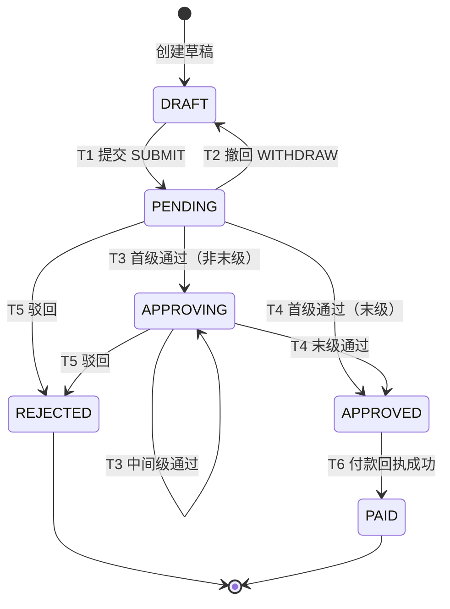

# 02 状态机设计

> 原则：**状态只由状态机改**。所有流转经同一入口 `ReportStateMachine.transit(reportId, event, ctx)` 校验并落库，禁止业务代码直接 `UPDATE status`。

## 1. 单据状态

| 码值 | 名称 | 含义 | 终态 |
|---|---|---|---|
| `DRAFT` | 草稿 | 可编辑、未进入审批 | 否 |
| `PENDING` | 待审批 | 已提交，等待第 1 级处理 | 否 |
| `APPROVING` | 审批中 | 至少 1 级已通过，后续级次处理中 | 否 |
| `APPROVED` | 已通过 | 全部级次通过，预算已实扣，待生成/确认付款 | 否 |
| `REJECTED` | 已驳回 | 任一节点驳回，流程终止，预算已释放 | 是 |
| `PAID` | 已付款 | 付款回执成功 | 是 |

## 2. 状态图



> 说明：`PENDING → DRAFT` 的撤回只允许在"无人动过"时发生；一旦有审批动作，撤回入口关闭。

## 3. 流转表

| 编号 | 事件 | 起点 | 终点 | 守卫条件（全部满足） | 副作用（同一事务） |
|---|---|---|---|---|---|
| T1 | `SUBMIT` | `DRAFT` | `PENDING` | ① 明细 ≥ 1 且金额 = 明细合计 > 0 ② 存在有效审批链（≥1 级、每级≥1 有效审批人）③ 预算可用额度 ≥ 金额 | 固化审批链快照；冻结预算（`FREEZE` 流水）；`submit_token` 落库；写审计 |
| T2 | `WITHDRAW` | `PENDING` | `DRAFT` | ① 操作人为申请人 ② 该单**没有任何**审批动作（全部节点 `PENDING`） | 释放冻结（`RELEASE`）；节点全部置 `CANCELLED`；写审计 |
| T3 | `APPROVE`（非末级） | `PENDING` / `APPROVING` | `APPROVING` | ① 当前节点属于操作人且 `PENDING` ② 本级满足通过规则 ③ 还有后续级次 | 节点置 `APPROVED`；级次 +1；未处理的同级节点按规则置 `SKIPPED`；写审计 |
| T4 | `APPROVE`（末级） | `PENDING` / `APPROVING` | `APPROVED` | 同 T3，且本级为 `total_steps` | 节点置 `APPROVED`；冻结转实扣（`DEDUCT`）；写 Outbox `REPORT_APPROVED`；`finished_at`；写审计 |
| T5 | `REJECT` | `PENDING` / `APPROVING` | `REJECTED` | ① 节点属于操作人且 `PENDING` ② 意见非空 | 节点置 `REJECTED`；释放冻结（`RELEASE`）；其余 `PENDING` 节点置 `CANCELLED`；`finished_at`；写审计 |
| T6 | `PAY_SUCCESS` | `APPROVED` | `PAID` | ① 付款单存在且 `CREATED` ② 金额一致 | 付款单置 `PAID`；`paid_at`；写审计 |

其余组合**一律非法**，返回 `409 STATE_ILLEGAL`，且不产生任何写入。

> **代码实现步骤（定稿）**：T3/T4/T5 的落地顺序见 [05-工程结构.md](05-工程结构.md) §5（锁整级 → 更新自己 → 判本级 → 推进单据），实现时以该节为准，不再另立顺序。

> **实现进度（与代码同步）**：T1 的第 ③ 条守卫（预算冻结）与 T2/T4/T5 的 `FREEZE/RELEASE/DEDUCT` 流水按 [06-预算冻结与扣减.md](06-预算冻结与扣减.md) 实现（完整流程与落地顺序见该文档）；当前提交只落**审批链快照 + 幂等 token + 审计**，撤回只做状态回退与节点作废。文档先行、代码补阶梯，避免第 1 周返工。
>
> **2026-10-31 补记**：T2 守卫①（操作人为申请人）已落地——`ReportController.withdrawReport` 从 `UserContext` 取身份，`ReportServiceImpl.withdrawReport` 校验 `operatorId == applicantId` 否则 40301；详情接口 `availableActions` 对非本人过滤 `SUBMIT`/`WITHDRAW`/`EDIT`（`docs/03` §3.1）。转交（§5）已实现：`ApprovalService.transfer`，原行 `PENDING → TRANSFERRED` + 同 `step_no` 新行 `PENDING`，防环校验目标不得为本单历史审批人。
>
> **2026-10-31 补记（删除草稿）**：`DELETE /reports/{id}` 是**逻辑删除**，不是状态流转——不进状态机、不写审计，只置 `expense_report.deleted=1` 并解绑发票；因此本表 T1–T6 不受影响，也不需要新增 T7。
>
> **2026-10-31 补记（SLA）**：§7 的超时提醒与自动升级已实现（`ApprovalSlaJob` → `ApprovalSlaService`），升级只换审批人（原节点 `SKIPPED` + 新节点 `PENDING`），**不改变单据状态**，与本节约束一致。

## 4. 审批节点状态

| 码值 | 含义 | 触发 |
|---|---|---|
| `PENDING` | 待处理 | 快照生成 / 转交插入新行 |
| `APPROVED` | 已通过 | 审批人通过 |
| `REJECTED` | 已驳回 | 审批人驳回 |
| `TRANSFERRED` | 已转交 | 审批人转交他人，原行失效 |
| `SKIPPED` | 被跳过 | 或签中他人已通过，同级其余节点直接作废；超时升级后原节点被替换 |
| `CANCELLED` | 已作废 | 单据撤回或驳回，未处理节点统一作废 |

节点状态只由单据流转驱动；**节点变化不直接改单据状态**，而是先算出"本级是否完成"，再触发 T3/T4/T5。

## 5. 会签 / 或签 / 转交

| 模式 | 通过条件 | 驳回 | 说明 |
|---|---|---|---|
| `SINGLE` 单签 | 该级唯一审批人通过 | 该人驳回 | 默认模式 |
| `AND` 会签 | 该级**全部有效节点** `APPROVED` | 任一节点驳回即整单驳回 | 并发审批时用 `SELECT ... FOR UPDATE` 统计剩余 `PENDING`，避免"都以为别人没批完" |
| `OR` 或签 | 该级**任一**节点通过 | 任一节点驳回即整单驳回 | 首个通过后，其余 `PENDING` 置 `SKIPPED` |
| 转交 | 不改变单据状态 | — | 原行 `PENDING → TRANSFERRED`，插入新行（同 `step_no`、新审批人、`transfer_from_id` 指向原行） |

- 转交**不重置**本级进度：会签中已通过的节点保持 `APPROVED`。
- 转交目标须为在职用户，且不得是本单任意节点的历史审批人（防环）。

## 6. 并发与幂等

- **状态推进**：`UPDATE expense_report SET status=?, current_step=?, version=version+1 WHERE id=? AND status=? AND version=?`，影响行数为 0 即冲突，重试或返回"处理中"。
- **节点审批**：`UPDATE expense_approval SET status='APPROVED' ... WHERE id=? AND status='PENDING'`，影响行数为 0 说明已被处理（重复点击/消息重投），按幂等处理：返回当前单据状态，不报错。
- **重复审批请求**：唯一键 `(report_id, step_no, approver_id)` 保证最多一条任务；重复请求命中同一条，不产生第二条审计记录。
- **重复提交**：`uk_submit_token` 冲突 → 回查该 token 对应单据，返回同一结果（HTTP 200），不新建单。

## 7. 超时提醒与自动升级

- `deadline_at` 在生成快照时按"提交时间 + 每级 SLA"计算（默认主管 24h、财务 24h、分管 48h）。
- 定时任务每 10 分钟扫描 `expense_approval`：`status='PENDING' AND deadline_at < now()`。
  - 首次超时：站内信/邮件提醒，`expense_status_log` 记 `TIMEOUT_REMIND`（不改状态）。
  - 超时 > 1 个 SLA：自动升级为直属上级（`source_role` 为 `SUPERVISOR` 时升级到部门负责人），原节点置 `SKIPPED`，插入新节点，记 `TIMEOUT_ESCALATE`。
- 升级**不改变单据状态**，只换人；因此不破坏状态机约束。

> **实现说明（2026-10-31）**：`ApprovalSlaJob`（cron 可配，默认每 10 分钟）扫描**当前级**已过 `deadline_at` 的 `PENDING` 节点：
> - 未超 1 个 SLA → 写 `TIMEOUT_REMIND` 审计，同一节点 1 小时内去重（`approval.sla.remind-interval-hours`）；
> - 超 1 个 SLA → 原节点 `PENDING → SKIPPED`，插入同 `step_no` 新节点（`transfer_from_id` 回指原行，deadline 顺延一个 SLA），写 `TIMEOUT_ESCALATE`；
> - 升级目标：主管级 → 本部门负责人，找不到就逐级往上找上级部门；财务/分管 → 同角色另一位在职用户，兜底 `ADMIN`；**找不到人只记日志、不改数据**。
> - 每个节点独立事务，失败不影响本轮其他节点；配置见 `application.yaml` 的 `approval.sla.*`。

## 8. 审计日志

每次流转（含失败的关键尝试）写一条 `expense_status_log`：

```json
{
  "traceId": "a1b2c3d4",
  "reportId": 1001,
  "action": "APPROVE",
  "fromStatus": "PENDING",
  "toStatus": "APPROVING",
  "operatorId": 2,
  "operatorName": "张三",
  "detail": { "stepNo": 1, "approvalId": 55, "comment": "金额与发票一致", "amount": 3200.00 }
}
```

- 只追加，不更新、不删除；查询按 `(report_id, created_at)` 回放时间线。
- 失败尝试（`STATE_ILLEGAL`）写应用日志 + 指标，不落审计表，避免污染轨迹。
