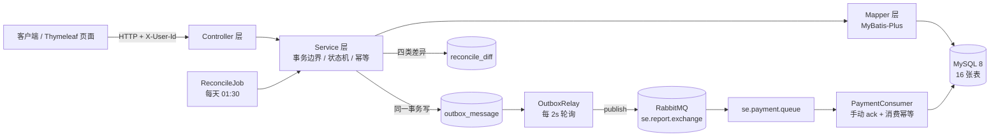

# 09 系统架构

> 面试/答辩用的全景文档：一次看清系统由哪些部分组成、一次请求怎么走、数据怎么保持一致。
> 实现细节分别见 `02-状态机.md`、`05-工程结构.md`、`06-预算冻结与扣减.md`、`07-Outbox与消息一致性.md`、`08-对账与自动补偿.md`。

---

## 1. 全景图



关键点：**同步链路负责业务正确性，异步链路负责下游最终一致，对账负责兜底。**

---

## 2. 模块与职责

| 模块 | 代码位置 | 职责 |
|---|---|---|
| 报销单 | `ReportController` / `ReportServiceImpl` | 建草稿、详情、提交（审批链快照 + 幂等 + 预算冻结）、撤回（释放 + 节点作废） |
| 审批 | `ApprovalController` / `ApprovalServiceImpl` | 待办列表、通过/驳回（锁整级 → 条件更新 → 判本级 → 推进单据 → 审计） |
| 预算 | `BudgetService` / `BudgetServiceImpl` | `freeze`（提交）、`release`（撤回/驳回）、`deduct`（末级通过），全部条件更新 |
| 消息 | `OutboxService` + `job/OutboxRelay` + `mq/PaymentConsumer` | 本地消息表写入、租约投递、指数退避、手动 ack、消费幂等、死信 |
| 付款 | `PaymentController` / `PaymentServiceImpl` | 付款单查询、回执确认（T6） |
| 对账 | `ReconcileService` + `job/ReconcileJob` + `AdminReconcileController` | 四类差异检出、自动补偿、人工修复 |
| 状态机 | `ReportStateMachine` | T1~T6 流转的唯一判定点，表驱动 |
| 公共 | `common`（Result/ErrorCode/BizException/PageResult） | 统一响应与错误码 |

---

## 3. 核心链路时序

### 3.1 提交（同步 + 写 Outbox 之前的阶段）

```
POST /reports/{id}/submit  (Idempotency-Key)
  ├─ 状态机 DRAFT → PENDING
  ├─ 解析审批链（主管 → 财务 → 分管），写审批节点快照
  ├─ 预算 FREEZE：条件更新 frozen，写 budget_txn(FREEZE:{reportId}:{token})
  ├─ 条件更新单据：status/current_step/total_steps/submit_token/budget_id
  └─ 审计 SUBMIT
```

### 3.2 末级审批通过（同步 + 异步分界点）

```
POST /approvals/{id}/approve
  ├─ 锁整级（FOR UPDATE）→ 更新自己（WHERE status='PENDING'）
  ├─ 判本级（SINGLE/AND/OR）
  ├─ 条件更新单据（current_step+1 或 APPROVED+finished_at）
  ├─ 预算 DEDUCT（frozen→used）
  ├─ 写 outbox_message(REPORT_APPROVED, NEW)     ← 同事务
  └─ 审计 APPROVE
        │ 事务提交
        ▼
OutboxRelay：租约 → publish → SENT / FAILED 退避 / DEAD
        ▼
PaymentConsumer：mq_consume_log 幂等 → 建 payment_order → ack
```

### 3.3 付款确认（T6）

```
POST /payments/{id}/confirm
  ├─ 付款单 CREATED、单据 APPROVED（状态机）
  ├─ 金额一致校验
  ├─ 条件更新付款单 CREATED→PAID
  ├─ 条件更新单据 APPROVED→PAID
  └─ 审计 PAY
```

### 3.4 每日对账

```
ReconcileJob(01:30) → ReconcileService.run(T-1)
  ├─ 幂等批次（uk_biz_date）
  ├─ 扫 APPROVED/PAID 单
  ├─ 四类检查 → 写 reconcile_diff（uk_date_type_report）
  ├─ 自动修复：缺扣补扣 / 缺付款单重放消息
  └─ 批次 DONE（修复失败仅影响单条，留 OPEN）
```

---

## 4. 一致性设计（面试重点）

| 问题 | 手段 | 位置 |
|---|---|---|
| 重复提交 | `submit_token` 唯一索引 + 幂等回放 | `ReportServiceImpl` |
| 重复审批 | 整级 `FOR UPDATE` + `WHERE status='PENDING'` 条件更新 | `ApprovalServiceImpl` |
| 预算超发 | `WHERE total-used-frozen >= amount` 条件更新 | `BudgetServiceImpl` |
| 消息不丢 | Outbox 与业务同事务，调度器轮询重试 | `OutboxRelay` |
| 消息重复 | `msg_id` + `mq_consume_log` 联合主键 + `uk_report` | `PaymentConsumer` |
| 修复不重复 | `DEDUCT:{reportId}` 流水唯一键 | `BudgetServiceImpl` |
| 对账幂等 | `uk_biz_date` + `uk_date_type_report` | `ReconcileServiceImpl` |
| 数据不一致 | 每日对账 + 自动补偿 + 人工修复 | `ReconcileJob` |

三层唯一键 = 三层幂等：`outbox.uk_msg_id` → `mq_consume_log(msg_id, consumer)` → `payment_order.uk_report`。

---

## 5. 状态机一览

```
DRAFT --T1 SUBMIT--> PENDING --T3 APPROVE--> APPROVING --T4 APPROVE--> APPROVED --T6 PAY--> PAID
  ▲                     │                                                  │
  └── T2 WITHDRAW ◄─────┘                                                  │
                        └── T5 REJECT ──────────────────────────────► REJECTED
```

- 节点状态：`PENDING / APPROVED / REJECTED / TRANSFERRED / SKIPPED / CANCELLED`
- 每次流转必须在同一事务内完成：节点、单据、预算、Outbox、审计。

---

## 6. 技术栈与运行时

| 组件 | 版本/端口 | 用途 |
|---|---|---|
| Spring Boot | 4.1.1（Java 17 目标） | Web / 事务 / 调度 |
| MyBatis-Plus | 3.5.17 | CRUD + 条件更新 |
| MySQL | 8，宿主 3307 | 主存储，16 张表 |
| RabbitMQ | 3.13，5672 / 15672 | 异步消息、死信 |
| Redis | 7，6380 | 预留给缓存/分布式锁（当前未用） |
| JUnit 5 + Mockito | — | 27 个测试（状态机、提交/撤回、付款、Outbox、对账） |

启动顺序：`docker compose up -d` → `./mvnw spring-boot:run`（默认连 3307）。

---

## 7. 包结构

```
controller/   HTTP 入口
service/      业务接口
service/impl/ 事务与业务实现
mapper/       BaseMapper + 少量 @Select
entity/       表映射
dto/ vo/      入参 / 出参
enums/        状态与事件
statemachine/ 表驱动状态机
config/       RabbitMQ 拓扑
job/          OutboxRelay、ReconcileJob
mq/           PaymentConsumer
common/       Result、ErrorCode、异常、分页
```

依赖方向：`controller → service → impl → mapper → entity`，Entity 不对外暴露。

---

## 8. 设计取舍与局限

**已做**

- 审批、预算、消息、对账四条链路都有并发与幂等保护，并有真实验证记录（`docs/06` §10、`docs/07` §10）。
- 状态机表驱动，新增流转只改表不改 if-else。

**已知局限（面试可主动说）**

- 认证只到 `X-User-Id`，JWT 与角色校验是第 5 周计划；
- Redis 未接入，超时升级/分布式锁还没做；
- 单 JVM 验证，多实例的租约与幂等靠数据库约束，未做集群压测；
- 对账窗口按 `finished_at` 扫描，超大表需要按时间分区或加索引优化；
- 付款只做到"确认回执"，没有真实银行对接。

---

## 9. 一句话总结

> 同步链路用**状态机 + 条件更新 + 唯一键**保证单次操作正确；跨服务动作走 **Outbox + MQ + 消费幂等**保证最终一致；再用**每日对账**兜住所有没预料到的失败。
